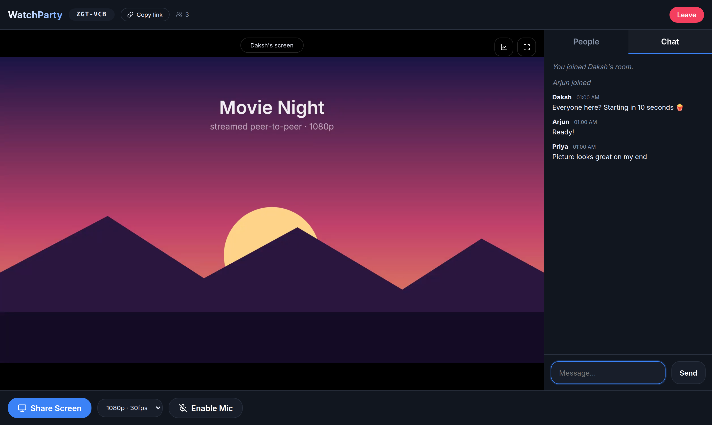
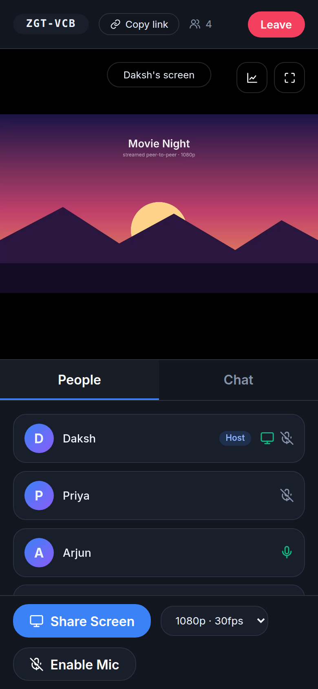
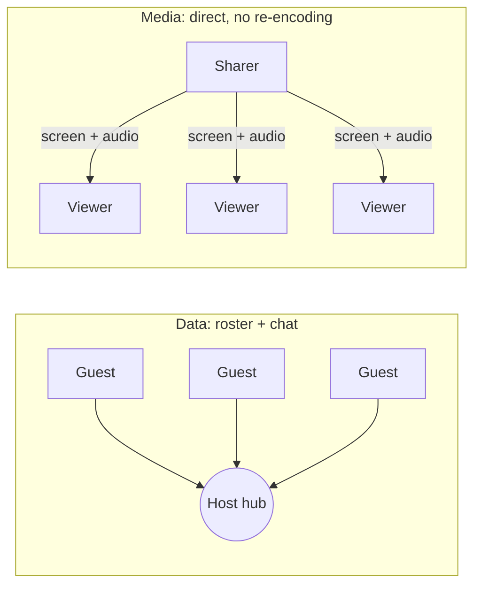

<div align="center">

# 🍿 WatchParty

**Watch together, peer to peer.**<br>
Share your screen in 1080p with sound, chat, and talk, right in the browser.<br>
No accounts. No installs. No backend.

[**▶ Open WatchParty**](https://dakshhpanchal.github.io/watchparty/)




</div>

---

## ✨ Features

| | |
|---|---|
| 🖥️ **Screen sharing** | Share a tab, window or whole screen, including audio. Anyone in the room can share (one at a time). |
| 🎚️ **Quality presets** | 1080p 30fps, 1080p 60fps or 720p 30fps. You can switch while sharing. |
| 🎙️ **Voice** | Per-person mic with echo cancellation, noise suppression and auto gain. |
| 💬 **Chat** | Live text chat with an unread badge. |
| 👥 **People list** | Everyone in the room, with host, mic and sharing indicators. |
| 🔗 **Invite links** | One click copies a `?room=ABC-123` link that pre-fills the code. |
| 🔁 **Host migration** | If the host leaves, the next person takes over automatically and the stream keeps playing. |
| 📊 **Stream stats** | Live resolution, fps, bitrate, codec, packet loss, latency, and whether you're on a direct or relayed connection. |
| 📱 **Mobile friendly** | Phones can join and watch; the layout stacks on narrow screens. |

<p align="center">
  
</p>

## 🚀 Quick start

**Use it:** open **[dakshhpanchal.github.io/watchparty](https://dakshhpanchal.github.io/watchparty/)**.

1. **Host:** enter your name → **Create Room** → **Copy link** → send it to friends.
2. **Friends:** open the link → enter a name → **Join Room**.
3. **Share:** pick a quality → **Share Screen**. In the browser picker, tick **"Share audio"** to include sound.

**Run it locally:** it's just static files.

```sh
git clone https://github.com/dakshhpanchal/watchparty.git
cd watchparty
python3 -m http.server 8000     # open http://localhost:8000
```

> [!NOTE]
> Screen capture needs a desktop browser (Chrome, Edge, Firefox) on `https://` or `localhost`. Phones can join and watch, but mobile browsers can't share their screen.

## 🧠 How it works

WatchParty is built on [WebRTC](https://webrtc.org/) via [PeerJS](https://peerjs.com/). PeerJS's free public server is only used to introduce peers to each other ("signaling"). Your video never goes through it.



- **Media goes direct.** Screen and mic streams go straight from their owner to each viewer. Nothing is relayed or re-encoded by the host, which keeps latency low and picture quality high.
- **The host is a hub for data.** The host's browser registers the room's well-known ID (`watchparty-v2-<CODE>`). Guests connect to it for the people list and chat. The host also makes sure only one person shares at a time.
- **Host migration:** everyone knows the join order. When the host leaves, the earliest guest takes over the room ID and the others reconnect to it. Streams between the remaining people never stop.
- **Tuned for video:**
  - H264 is the preferred codec (hardware-accelerated on most devices).
  - Each quality preset sets a bitrate cap, and the encoder drops resolution before it drops frames.
  - Video starts at about 2.5 Mbps instead of ramping up slowly from a low bitrate.
  - Screen audio is stereo Opus at 128 kbps.

## 🌐 Connectivity & TURN

Most of the time devices connect directly. When they can't (mobile data, Wi-Fi with client isolation, strict corporate networks), traffic falls back to a **TURN relay** that forwards the encrypted stream.

- The app ships with a free [ExpressTURN](https://www.expressturn.com/) relay configured in `CONFIG.iceServers` at the top of [`app.js`](app.js).
- Only relayed connections use its quota. 1080p30 uses about 2.7 GB per relayed viewer per hour.
- To use your own relay (coturn, Metered, Twilio, Cloudflare…), replace that entry:

```js
iceServers: [
  { urls: ['stun:stun.l.google.com:19302'] },
  { urls: ['turn:your.turn.server:3478', 'turn:your.turn.server:3478?transport=tcp'],
    username: 'user', credential: 'pass' },
],
```

TURN credentials in a static site are public by nature. Use a provider with a usage cap.

## 🩺 Troubleshooting

| Symptom | What to do |
|---|---|
| **"Room not found"** | Check the code. The host must still have the tab open. |
| **"Couldn't connect to the host"** | The network is blocking peer-to-peer traffic and the relay couldn't help. Try another network, or check your TURN credentials and quota. |
| **Viewers see lag or blur** | Open 📊 stats on the **sharer's** screen. `LIMIT:bandwidth` means pick **720p30**; `LIMIT:cpu` means pick a 30fps preset. |
| **No sound** | Tick **"Share audio"** in the share picker. Viewers may need to click **"Click to enable audio"** once. |
| **Old version after an update** | GitHub Pages caches for about 10 minutes. Hard-refresh, or use a private tab. |

## 📁 Project structure

```
watchparty/
├── index.html   # markup
├── style.css    # styles
├── app.js       # all app logic, with CONFIG at the top
└── docs/        # README screenshots
```

## ⚠️ Limitations

- **Small rooms:** the sharer uploads one stream per viewer, so this works best for about 2–8 people.
- **No persistence:** a room exists only while someone is in it. Nothing is stored anywhere.
- **No access control:** anyone with the room code can join.
